# Hands-On Lab — Environment Setup (Kind Cluster)

## Step 1: Create the 3-Node Kind Cluster

Same K8s Cluster - dso202.

Verify your nodes:
```bash
docker ps
```
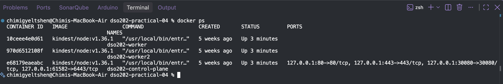
```bash
kubectl get nodes
```
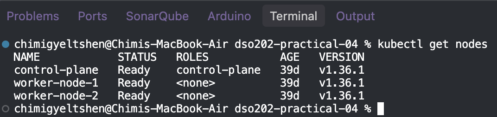

Step 2: Install Argo CD on the Cluster
Argo CD should always live in its own dedicated namespace called argocd.
```bash
# 1. Create the namespace
kubectl create namespace argocd

# 2. Apply the official stable Argo CD installation manifest
kubectl apply -n argocd -f https://raw.githubusercontent.com/argoproj/argo-cd/stable/manifests/install.yaml

```
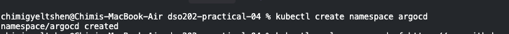
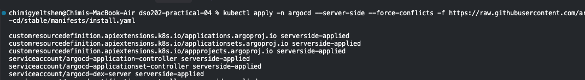
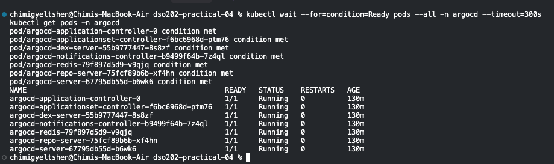

Step 3: Access the Argo CD UI & Get Admin Credentials
1. Retrieve the auto-generated initial password:
```bash 
kubectl -n argocd get secret argocd-initial-admin-secret -o jsonpath="{.data.password}" | base64 -d; echo

password = NtGAgbw0O9qtUrEz
```

2. Forward local port 8080 to the Argo CD API Server:
```bash 
kubectl port-forward svc/argocd-server -n argocd 8080:443
```
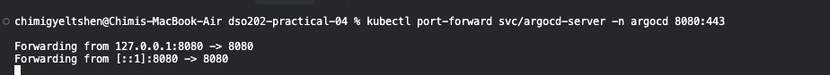

3. Log into the Web UI:

* Open your browser and go to: https://localhost:8080
* Your browser will show a "Your connection is not private" warning (because Argo CD uses a self-signed TLS certificate out of the box). Click Advanced 
 Proceed to localhost (unsafe).
* Log in with:
Username: admin
Password: (Paste the password from Step 1)

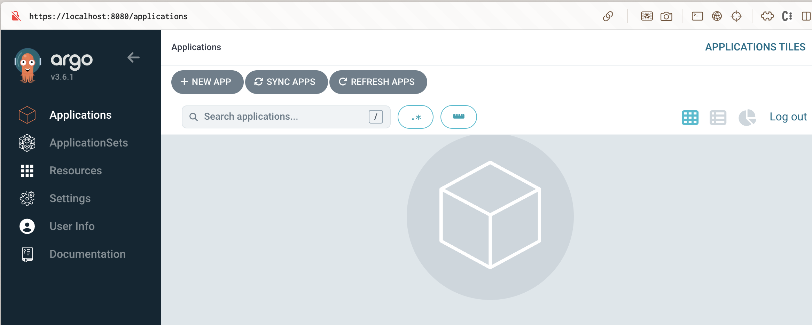

Module 5: Hands-On Lab — Your First GitOps Pipeline

Step 1: Prepare Your GitHub Repository (The Desired State)

1. Log into your GitHub account and create a new Public repository named dso202-gitops-demo (Check "Add a README file" so the main branch is initialized).
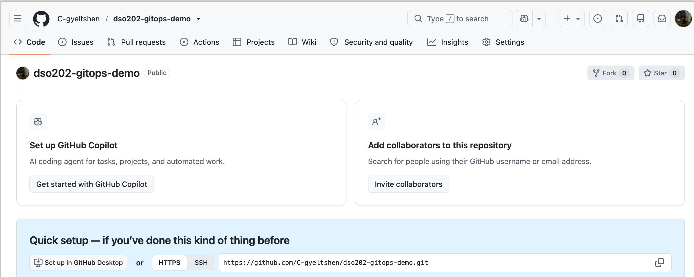

2. Clone the repository to your laptop (or create the files directly in the GitHub web interface):
```bash 
git clone https://github.com/<YOUR-GITHUB-USERNAME>/k8s-gitops-demo.git
cd k8s-gitops-demo
```
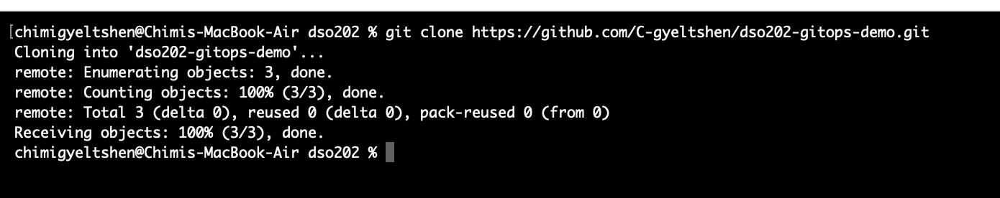

3. Inside the repository, create a folder named manifests and add two files inside it: deployment.yaml and service.yaml.
```bash
mkdir manifests
```


Create manifests/deployment.yaml:


Create manifests/service.yaml:


commit and push the code.

```bash 
git add .
git commit -m "Initial deployment with 2 replicas"
git push origin main
```
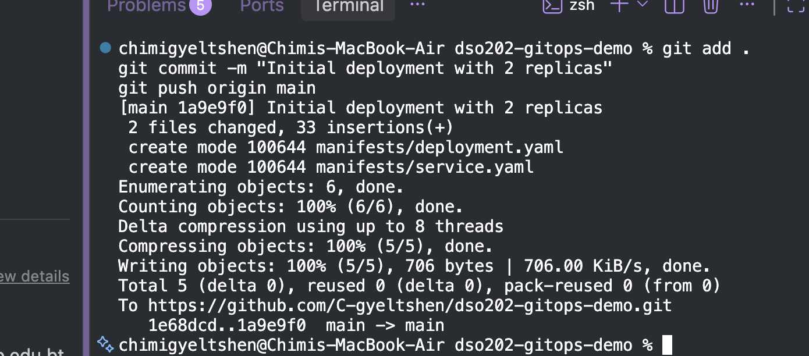

Step 2: Register the Application in Argo CD (Declaratively!)
While you can click "+ NEW APP" in the Argo CD Web UI to connect your repository, true GitOps engineers define the Argo CD Application itself as a Kubernetes YAML file!

On your laptop (outside the Git repo if you prefer), create a file named argocd-app.yaml. Make sure to replace <YOUR-GITHUB-USERNAME> with your actual GitHub username:


Apply this CRD to your cluster:
```bash
kubectl apply -f argocd-app.yaml
```
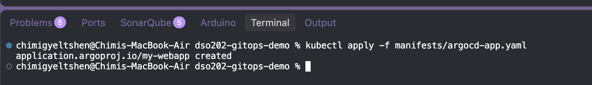

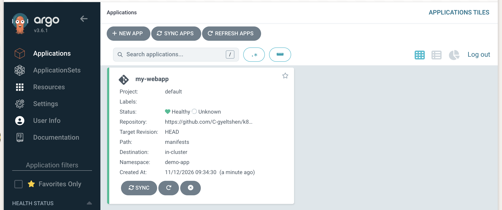

the namespace demo-app is not created in the instructoin so i am creating the namespace `manifest/namespace.yaml`

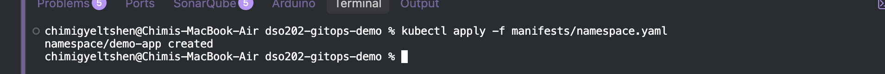


```bash 
kubectl get pods -n demo-app -o wide
```
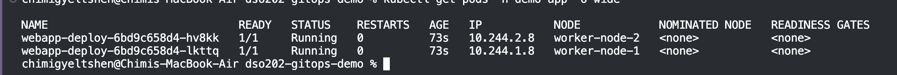

Step 3: Experiment 1 — Git as the Single Source of Truth

1. Let's scale our application from 2 replicas to 4 replicas the GitOps way.

2. Go to your GitHub repository (manifests/deployment.yaml).
Change replicas: 2 to replicas: 4.

3. Commit and push the change to main (or edit and commit directly in the GitHub browser UI).
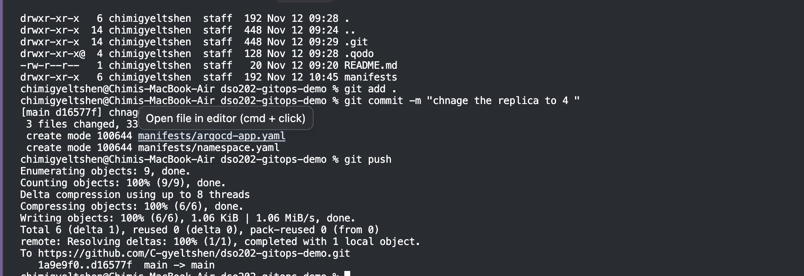
4. Go to the Argo CD UI.
    * Remember: By default, Argo CD polls GitHub every 3 minutes. If you don't want to wait 3 minutes, click the "Refresh" button at the top of the Argo CD UI.
    * The moment Argo CD sees the new commit hash, watch the visual graph automatically spin up 2 new pods!


Step 4: Experiment 2 — Configuration Drift & Self-Healing
Now let's simulate a "rogue admin" who bypasses Git and modifies the cluster manually using kubectl.

1. Keep your Argo CD UI open on the screen so you can watch the pod tree live.
2. In your terminal, manually scale the deployment down to 1 replica:

```bash 
kubectl scale deployment webapp-deploy -n demo-app --replicas=1
```


Step 5: Experiment 3 — Automatic Pruning
What happens if we no longer need a resource and remove it from Git?

1. In your GitHub repo (k8s-gitops-demo), delete the manifests/service.yaml file and commit the deletion.
2. Click Refresh in the Argo CD UI.
3. Because we enabled prune: true, Argo CD sees that service.yaml no longer exists in Git and automatically deletes webapp-svc from the demo-app namespace.
4. (Optional) Use git revert HEAD to bring the Service back!